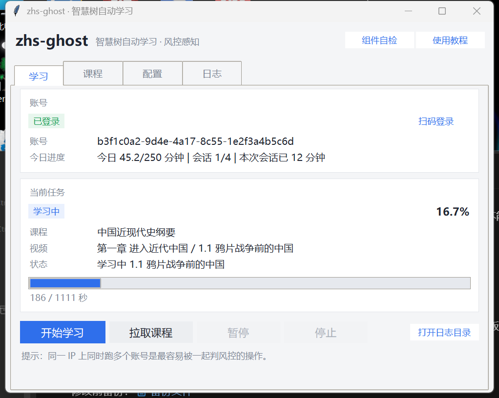
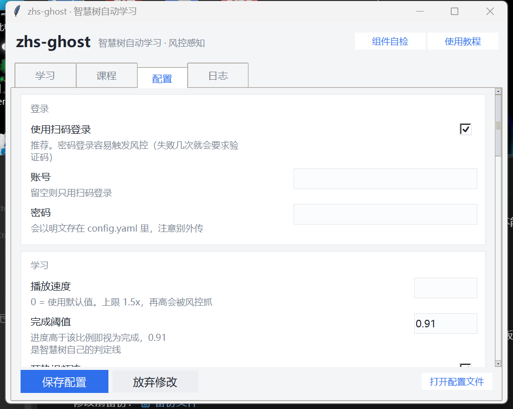
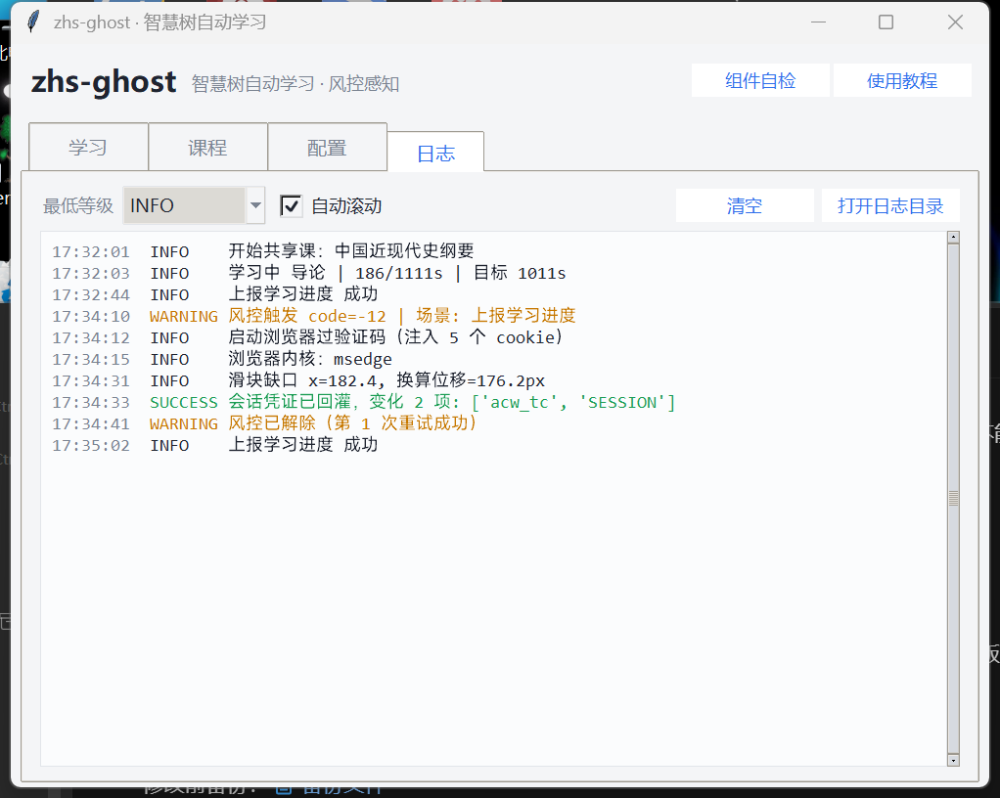

# zhs-ghost — 智慧树自动学习工具

[](https://github.com/skyslight1/zhs-ghost/actions/workflows/tests.yml)
[](LICENSE)
[](pyproject.toml)

借鉴 [fuckZHS](https://github.com/VermiIIi0n/fuckZHS)（MIT）的接口分析成果，
从源码层面重写的一份实现。

**核心差别：原项目把"人机验证"当成需要打补丁的意外，这份实现把它当成必然会发生的事件，直接设计进请求层。**

---

## 快速开始



### 方式一：下载 exe（不碰命令行）

去 [Releases](https://github.com/skyslight1/zhs-ghost/releases) 下载，放进一个**单独的空文件夹**，双击。

第一次运行会自动生成 `config.yaml`，**什么都不用改**；再点一次「扫码登录」，
手机「知到」App 扫一下，就可以点「开始学习」了。

| 文件 | 说明 | 体积 |
|---|---|---|
| `zhs-ghost-gui.exe` | **图形界面** + 验证码自动识别 | ~200MB |
| `zhs-ghost-lite-gui.exe` | **图形界面**，验证码浏览器自动打开、你滑一下 | ~25MB |
| `zhs-ghost.exe` | 命令行版 + 验证码自动识别（给服务器 / 脚本用） | ~200MB |
| `zhs-ghost-lite.exe` | 命令行精简版 | ~25MB |
| `*-windows-x64.zip` | 上面某个的压缩包，附带教程与示例配置 | — |

四个版本都不需要装 Python，也不需要装浏览器 —— 验证码中继会用系统自带的 Edge。

> Windows 首次运行可能弹「SmartScreen 已阻止」。点「更多信息」→「仍要运行」。
> exe 没有代码签名证书，不是病毒。

### 方式二：源码运行

```bash
git clone https://github.com/skyslight1/zhs-ghost.git
cd zhs-ghost
pip install -r requirements.txt
python -m playwright install chromium    # 可选，用系统 Edge 也行

python gui.py                            # 图形界面
python main.py --dry-run                 # 命令行：自检，不连网站
python main.py --fetch                   # 命令行：拉课程清单
python main.py -c 1919                   # 命令行：刷课
```

### 📖 文档

| 文档 | 内容 |
|---|---|
| [**使用教程**](docs/使用教程.md) | 图形界面 + 命令行，从零到跑通，含配置说明与排错手册 |
| [打包说明](docs/打包说明.md) | 自己构建 exe、改打包配置 |
| [README 第 4 节](#4-图形界面) | 界面各页的作用 |
| [README 第 2 节](#2-触发根因对着源码逐条) | 为什么会弹人机验证（对着 fuckZHS 源码逐条分析） |

---

## 1. 先把话说清楚：`-12` 是什么

看原项目的链路：

```python
# fucker.py:606-637   zhidaoQuery
ret = self._apiQuery(...)
if ok_code is not None and ret.code != ok_code:
    match ret.code:
        case -12:
            e = CaptchaException("captcha required")   # ← 服务端风控，不是前端滑块
```

```python
# fucker.py:470-476   fuckZhidaoCourse
except CaptchaException:
    self._pushplus("fuckZHS", "需要提供验证码")
    return           # ← 整门课直接结束
```

`code: -12` 是**服务端风控**下的信号。网页端的表现是播放器弹出滑块/点选框，
人过掉之后服务端给这个会话下发新凭证（落在 Cookie 上），上报才恢复。

所以"写个程序解决"必须拆成两半，只做后一半会陷入"过完又来"的循环：

| 目标 | 手段 | 权重 |
|---|---|---|
| 让它**尽量不弹** | 把上报的行为特征做成真人 | 8 成 |
| 弹了**能自己过去** | 浏览器过检 + 凭证回灌 + 自动重试 | 2 成 |

---

## 2. 触发根因（对着源码逐条）

### 2.1 上报间隔精确到 0.0 秒

```python
db_interval = 30
while played_time < end_time:
    time.sleep(1)
    played_time += speed
    if elapsed_time % db_interval == 0:
        saveDatabaseIntervalTimeV2(...)
```

`elapsed_time` 每次 +1、循环体 `sleep(1)`，参数化后间隔永远贴在 30.0。
真人的间隔至少会有 ±2 秒抖动（tab 切换、GC、重传）。
**时间序列是风控最廉价也最准的判据，这是首要嫌疑。**

### 2.2 时间戳毫秒位恒为 000

```python
_t = int(time.time())*1000     # 先把毫秒抹掉，再乘 1000
data["dateFormate"] = _t
```

统计一下"毫秒位为 0 的请求占比"：脚本用户接近 100%，真人约 1%。
单条命中最强的特征。

> 原文注释写 "somehow their timestamps are ending with 000" —— 那大概是抓包
> 时看到的巧合。不管来源如何，全量 000 都是自杀。

### 2.3 请求头自相矛盾且全网共用

```python
"sec-ch-ua": '" Not A;Brand";v="99", "Chromium";v="101", "Google Chrome";v="101"',
"User-Agent": "...Chrome/100.0.4896.127 Safari/537.36",
"Accept-Language": "en-GB,en;q=0.9"
```

- UA 是 Chrome **100**、Client Hints 是 Chrome **101** —— 版本对不上；
- 一个刷中国高校网课的人用英式英语浏览器；
- 这套头是**所有跑这个脚本的人共用的** → 指纹群一脏，后来者挂久都被连带打上 `-12`。

### 2.4 观看点每批都从 `0,1` 重来

```python
# zd_utils.py:51-53  WatchPoint.reset
self.wp = [0, 1]        # 每批次上报都带着这一对
```

真前端的观看点是一条**连续推进**的已观看时间轴。

### 2.5 进度曲线过于完美

线性、单调、零卡顿、零回退、跨视频无缝衔接；
暂停概率 `0.0025/tick` 意味着平均 400 秒才停一次，且固定停 60 秒。

### 2.6 加速度自首

`-s 444` 直接把 `Δprogress/Δtime` 打到 444，而前端上限只有 1.5。

### 2.7 会话时长

连续在线 8 小时、凌晨满速推进 —— 时长是误伤率最低、最安全的判据。

---

## 3. 这份实现怎么改

### 3.1 结构：风控从"补丁"变成"请求层"

```
clock ──► pacer ──┐
                  ├──► HttpClient ──► Guard ──► ZhidaoApi / HikeApi / AiCourseApi
budget ───────────┘        ▲           │
                            │           └──► Relay（真实浏览器过检 + cookie 回灌）
                            └── Fingerprint（UA / Client Hints / Referer）
```

API 层**只负责协议**（组参、AES、签名、错误码），永远看不到验证码：

```python
ret = send()
if ret.code == CODE_CAPTCHA:
    ret = self.guard.call(lambda: ret, send, context="上报学习进度", rac_id=rac)
```

Guard 内部完成：唤浏览器 → 过检 → 回灌 cookie → 重新加密并重发。
业务代码感知不到，除非确实恢复失败才抛 `CaptchaRequired`。

### 3.2 节拍整形（权重最大）

| 项 | 原实现 | 现在 |
|---|---|---|
| 上报间隔 | 固定 30.0s | 对数正态 `[22,47]s`，5% 概率追加 70~200s（"人离开了"） |
| 循环 tick | `sleep(1)` 精确 1 秒 | `1.0 ± 0.06s` 抖动 |
| 时间戳 | `int(time.time())*1000`（`*000`） | 真实毫秒 + ±40ms，严格单调递增 |
| 播放速度 | 想要多少给多少 | 夹到 ≤1.5x，触顶时**单向向下**抖（向上会被 clamp 吃掉） |
| 微暂停 | 固定 60s，只在暂停瞬间补一枪 | 随机 10~70s，暂停开始后 2.5~9s 补一次 `playTimes≈0` 的报告 |
| 观看点 | 每批从 `0,1` 重来 | 连续覆盖，`take()` 不清游标 |
| 视频之间 | 无 | 4~90s 随机 |

### 3.3 会话纪律

```
单次会话    无限    → 95~160 分钟（随机），到点强制休息
休息        无      → 20~55 分钟
单日总量    无上限  → 250 分钟
单日会话数  无      → 4 次
跨天        无      → 自动清零
```

`Budget.tick()` 超限时直接抛 `BudgetExhausted`，沿着
课程 → 章节 → 视频 三层循环一路退出，CLI 捕获后打印"正常收工"。

### 3.4 验证码中继

```
1. 用同一份 Cookie 启动真实浏览器（持久化 profile，指纹固定）
2. 打开学习页，真实 CDP 鼠标动几下激活 userActivation
3. 等验证码弹出（最长 75s）
4. ddddocr 自动过：
     滑块 → slide_match 求缺口 x → 贝塞尔轨迹 + 过冲回拉拖动
     点选 → detection 定位候选块 → classification 逐块 OCR → 按提示语顺序点击
5. 自动解连续失败 → 响铃 + 推送，浏览器就开着等人滑一下
6. 把浏览器的新 Cookie **合并**进 HttpClient
7. Guard 重新加密 payload 重发（不复用密文 —— 密文含随机 IV）
```

第 6 步是关键：必须合并、且必须保持 `uuid` 与 `CASLOGC` 同步，
否则下一次请求会把旧凭证带回去，你就在原地循环。

### 3.5 顺手修掉的两个原项目缺陷

- **校内课死循环**：原实现 `prev_time, played_time = ret_time, ret_time`，
  配合 `while played_time <= end_time`，一旦服务端返回原地不动就永远退不出。
  现在只采纳"服务端比我们走得更远"的值，绝不回退。
- **考试答案缓存质量**：复核阶段服务端会返回每题的 `isCorrect` 标记，
  原实现只用来判断要不要重考。现在把正确选项抓下来写进缓存 ——
  这是把"猜对"变成"知道"的唯一机会。

---

## 4. 图形界面

双击 `zhs-ghost-gui.exe` 打开。四个页面：

| 页面 | 作用 |
|---|---|
| **学习** | 账号状态、当前视频与进度条、开始 / 暂停 / 停止 |
| **课程** | 课程列表，点第一列勾选；**双击某一行 = 只刷这一门** |
| **配置** | 常用项做成表单，改完点保存；冷门项走「打开配置文件」 |
| **日志** | 实时日志，按等级着色，可过滤 |



几个刻意的设计：

- **打开程序不会自动开始**。否则你只是想看看，它已经在后台连发几小时上报了。
- **停止是立即的**。一次会话休息可能是 40 分钟，直接 `sleep` 会让你点了停止还要干等。
  `StudyRunner._rest()` 以 0.5 秒为粒度检查停止标志。
- **暂停同理**，走同一个闸门 `observer.ControlObserver.gate()`。
- **改配置不影响正在跑的任务**。App 已经拿着旧值，界面会提示「已生效于下次运行」。
- **一个任务在跑时不让开第二个**。两个线程同时写 `state.json` 会把登录态和配额写坏。

日志页：



> 用的是 Tkinter（Python 标准库），刻意没引 PySide6 —— 那会让 exe 多出 80MB。
> 代价是得自己写样式，见 `zhsgo/gui/theme.py`。

---

## 5. 目录

```
zhsgo/
├── main.py                      CLI 入口
├── config.example.yaml          全量注释配置
├── packaging/
│   ├── build.py                 一键打包脚本（自动自检）
│   ├── zhs-ghost.spec           PyInstaller 配置（full / lite 双变体）
│   └── version_info.txt         exe 版本信息
├── docs/
│   ├── 使用教程.md               从零到跑通 + 排错手册
│   └── 打包说明.md               自己构建 exe
├── zhsgo/
│   ├── clock.py                 可替换时钟（测试用假时钟跑完整循环）
│   ├── config.py                yaml → dataclass
│   ├── app.py                   依赖装配 + 跨进程状态
│   ├── cli.py                   参数解析、清单拉取、二维码渲染
│   ├── errors.py                异常体系（风控是独立类型）
│   ├── logger.py                终端 + 按天文件 + risk.log 单独留档
│   ├── notify.py                通知
│   ├── crypto/                  AES / ev 编解码 / hike MD5 签名
│   ├── net/                     指纹、HTTP 客户端、接口地址常量
│   ├── risk/                    Pacer 节拍 / WatchPoint / Budget / Guard
│   ├── relay/                   真实浏览器过检 + 人机化输入 + 验证码识别
│   ├── api/                     passport / zhidao / hike / aicourse / exam
│   ├── ai/                      LLM 后端 + 提示词 + 答案解析
│   └── runner/                  学习循环、AI 考试编排
└── tests/run_tests.py           零依赖自测（106 项）
```

---

## 6. 命令行

参数沿用原项目，老用户不用重新学。exe 用户把 `python main.py` 整个替换成 `zhs-ghost.exe` 即可：

```bash
python main.py -c <courseId|recruitAndCourseId>   # 刷指定课
python main.py -c 1919 -v 604                     # 只刷指定视频
python main.py -f                                 # 拉课程清单到 courses.json
python main.py -ai 114514 4444                    # 刷 AI 课程
python main.py -s 1.25 -t 0.95 -l 25              # 速度/阈值/单课时限
python main.py --no-relay                         # 关掉中继（只想看多久被拦时有用）
python main.py --budget                           # 看配额与节拍分布
python main.py --dry-run                          # 只自检
python main.py --install-browser                  # 下载 playwright chromium（通常用不到）
```

**双击 exe 不带任何参数** = 登录后自动处理全部课程。这是设计好的默认行为。

课程 ID 在网址里：共享课看 `recruitAndCourseId`（带字母），校内课看 `courseId`（纯数字）。

---

## 7. 调参速查

| 症状 | 改哪里 |
|---|---|
| 还是频繁 `-12` | `pacer.report_interval` 拉宽到 `[25,70]`、`max_speed` 降回 `1.25`、`budget.daily_minutes` 降到 `180` |
| 进度涨太慢 | 别动 `max_speed`，改 `budget.session_minutes` 拉长单次会话 |
| ddddocr 拖不到位置 | 调 `relay.slider_offset_fix`（负值往左） |
| 自动过检总失败 | `relay.manual_wait_seconds: 600` + 开着 `beep_on_manual` |
| 服务器无显示器 | `relay.headless: true`，但无头指纹更差，建议配 `xvfb-run` |
| 想看节拍是否真被打散 | `python main.py --budget`，会打出上报间隔直方图 |

## 8. 怎么确认生效

1. `--dry-run` 看首行指纹是 `Chrome/12x on Windows/macOS`，不是 `Chrome/0`；
2. 抓一次包：`dateFormate` 毫秒位不该全是 `000`；UA 版本与 `sec-ch-ua` 一致；
   `Referer` 是 `studyh5.zhihuishu.com`；
3. `--budget` 看上报间隔直方图应该铺开成一条分布，而不是立在一根柱子上；
4. `state/state.json` 里 `quota.sessions` 一天不超过 4，`seconds` 不超过 15000；
5. 最直接的：连跑三天，看 `-12` 还剩几次。

---

## 9. 测试

```bash
python tests/run_tests.py      # 核心：106 项，零依赖、不联网
python tests/gui_smoke.py      # 界面：18 项，建窗口、切页、模拟进度
```

106 项，零依赖、不联网、不登录。关键的是它**用假时钟把 300 秒的视频循环
在毫秒内跑完**，所以能真正断言节拍逻辑：

```
== 学习循环（共享课） ==
  [ok]  300 秒视频产生 8 次上报
  [ok]  上报间隔互不相同: [33.4, 13.2, 33.7, 22.1, 54.6, 39.2, 18.3]
  [ok]  没有任何一次恰好落在 30.0s（对照原实现）
  [ok]  除首批外观看点不回头
  [ok]  ΣplayTimes(273.0) ≈ 最终进度(273.0)
== 学习循环（暂停行为） ==
  [ok]  暂停期间仍按节拍上报（进度冻结的相邻上报 2 对）
```

原实现没有办法这样测 —— 它的节拍和时间戳硬编码在主循环里，没有可替换的时钟。

---

## 授权

MIT。接口分析、加密密钥、签名盐值、提示词模板等成果来自
[fuckZHS](https://github.com/VermiIIi0n/fuckZHS)（Copyright (c) VermiIIi0n），
完整版权声明见 [LICENSE](LICENSE)。
